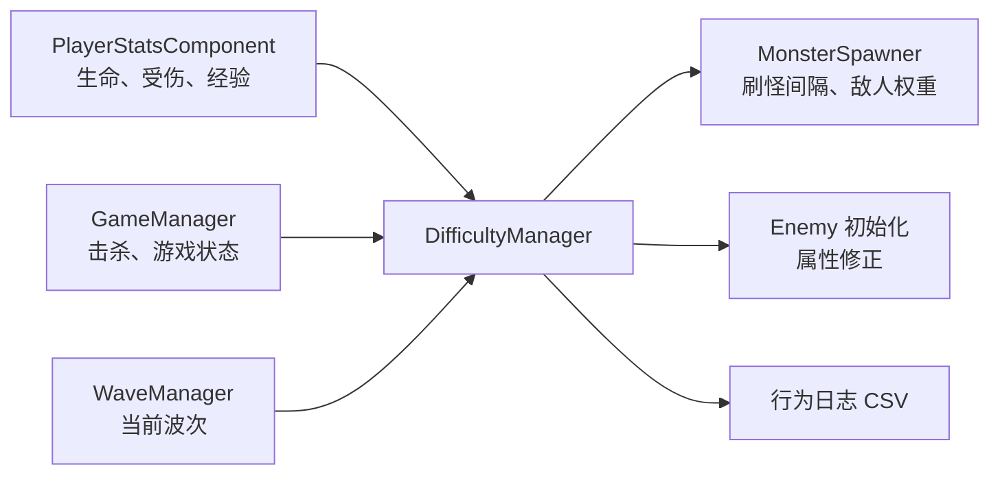

# 基于玩家行为的自适应难度调节系统设计

## 1. 课题定位

### 暂定题目

**基于玩家行为的自适应难度调节的 Unity 生存游戏设计与实现**

本项目在现有俯视角 Roguelike 生存游戏基础上，设计一套根据玩家近期表现调节游戏压力的规则系统。玩家仍按原有规则战斗、获得经验、升级和通过波次；系统只影响后续一段时间的敌人生成节奏、敌人组合和有限的敌人属性修正。

当前固定难度曲线只随波次增长，不能区分新手、熟练玩家和不同武器流派。课题目标是在保留波次总体递增的前提下，令挑战保持在合理区间，并将固定难度与自适应难度进行对照验证。

本课题采用可解释的规则模型，不使用机器学习、在线训练、复杂寻路或行为树，也不以大量增加武器和怪物作为主要工作。

## 2. 现有项目基础与新增范围

| 现有系统 | 当前作用 | 在课题中的用途 |
| --- | --- | --- |
| `WaveManager` | 波次和基础成长 | 提供不随自适应逻辑改变的基础难度 |
| `MonsterSpawner` | 生成敌人 | 接收刷怪间隔和敌人权重修正 |
| `EnemyDefinition` | 敌人基础数据 | 定义各类敌人的基础威胁 |
| `Enemy` 及其子类 | 近战、远程、冲刺行为 | 提供不同压力来源 |
| `PlayerStatsComponent` | 生命、经验、等级 | 提供行为数据 |
| `GameManager` | 游戏状态、击杀数 | 汇总事件和切换模式 |
| ScriptableObject | 配置数值 | 保存可调参数 |

现有 5 类敌人和 3 类武器足够支撑第一版。普通近战敌人可作为低压力填充，快速和冲刺敌人增加走位压力，远程敌人增加空间压力。无需先新增武器、怪物或复杂 AI。

新增 `DifficultyManager`，负责收集事件、统计近期数据、计算难度系数、向生成器和敌人初始化逻辑提供调节结果，并写入实验日志。建议新增 `DifficultySettings` ScriptableObject，集中保存阈值、权重和上限。

## 3. 系统结构



仅在 `Playing` 状态统计和调整。暂停、升级、主菜单、结算期间不累计窗口时间。

## 4. 行为数据与难度算法

每 10 秒评估一次。该周期要配置化；窗口过短会频繁变化，窗口过长则难以响应玩家状态。

| 指标 | 符号 | 采集方法 | 说明 |
| --- | --- | --- | --- |
| 当前生命比例 | `H` | 当前生命 / 最大生命 | 低值代表风险高 |
| 近期受伤比例 | `D` | 窗口受伤值 / 最大生命 | 连续受伤代表压力高 |
| 近期击杀效率 | `K` | 窗口击杀数 / 窗口秒数 | 高值代表清怪能力强 |
| 近期经验效率 | `X` | 窗口经验 / 窗口秒数 | 高值代表成长快 |
| 当前波次 | `W` | `CurrentWave` | 基础进度，不反复调节 |

为比较不同波次，`K` 和 `X` 应按当前波次目标值归一化到 0 至 1。目标值先从试玩日志中获得，之后写入配置。

定义压力评分 `P`：

```text
生命风险 R_h = 1 - H
受伤风险 R_d = Clamp01(D)
强度表现 S_k = Clamp01(K / K_target(W))
成长表现 S_x = Clamp01(X / X_target(W))

P = Clamp01(0.35 × R_h + 0.30 × R_d - 0.20 × S_k - 0.15 × S_x + 0.35)
```

`P` 越高，说明近期压力越大。公式权重是可调初始值，需以试玩和实验校准，论文中应明确其并非唯一最优解。

难度系数 `M` 初始为 1，每次评估最多变化 0.05，始终限制在 `[0.80, 1.20]`：

```text
P > 0.65：M = Max(0.80, M - 0.05)
P < 0.35：M = Min(1.20, M + 0.05)
其他情况：M 保持不变
```

这保证固定波次仍然总体变难，系统只做缓慢、有限的修正。

## 5. 调节方式

### 5.1 敌人生成间隔

```text
实际生成间隔 = 基础生成间隔 / M
```

`M > 1` 时刷怪更快，`M < 1` 时刷怪更慢。必须设置最小生成间隔，防止后期敌人数量失控。

### 5.2 敌人属性

波次仍提供基础属性。自适应系统只进行弱修正：生命限制在基础值的 90% 至 110%，接触伤害限制在 95% 至 105%。不建议大幅调节移动速度，因为会直接破坏走位体验。

### 5.3 敌人组合权重

生成逻辑改为从已解锁敌人中按权重选择：

| 当前难度 | 普通近战 | 快速/冲刺 | 远程 |
| --- | --- | --- | --- |
| `M < 0.95` | 提高权重 | 降低权重 | 降低权重 |
| `0.95 ≤ M ≤ 1.05` | 基础权重 | 基础权重 | 基础权重 |
| `M > 1.05` | 降低权重 | 提高权重 | 提高权重 |

该方式使挑战变化体现为敌人组合，不只是数值上涨。敌人仍必须满足原有解锁波次。

## 6. 模式、日志与实验

提供两个模式：固定难度模式仅使用原有波次公式，`M = 1`；自适应模式使用波次公式叠加有限修正。两种模式必须使用相同地图、角色、初始武器、敌人和升级配置。

开发版 HUD 显示模式、`M` 和最近评分 `P`，用于调试和论文截图；正式试玩版可隐藏技术数值。

每个评估窗口记录一行 CSV：

```text
session_id,mode,elapsed_seconds,wave,hp_ratio,damage_taken,kills_in_window,xp_gained,active_enemy_count,pressure_score,difficulty_multiplier,spawn_interval
```

对照实验建议由同一测试者体验两种模式，体验顺序交错或随机，以减少练习效应。记录存活时长、到达波次、击杀数、最终等级、生命变化、`M` 变化曲线，并使用 1 至 5 分问卷评价挑战是否合适、挫败感、单调感和再次游玩意愿。

## 7. 验收标准

1. 固定模式的玩法与改造前一致。
2. 自适应模式只按窗口更新，`M` 始终位于 `[0.80, 1.20]`。
3. 每次调整可以从日志追溯到对应的行为数据和评分。
4. 玩家残血或连续受伤时，系统不会继续提高压力。
5. 敌人组合始终遵守原有解锁波次。
6. 重开游戏后，难度系数、窗口统计和日志状态全部重置。
7. 高敌人数量下没有明显 GC 峰值或严重帧率下降。

## 8. 实施顺序

1. 修复现有重开、连续升级、无效或重复升级选项等核心流程问题。
2. 实现事件采集和 CSV 日志，暂不改变难度。
3. 增加固定/自适应模式开关。
4. 先接入刷怪间隔调节，确认日志和体验正确。
5. 接入敌人组合权重。
6. 最后接入小范围属性修正。
7. 试玩、校准参数、完成固定/自适应对照实验。

## 9. 论文结构建议

1. 绪论：固定难度在生存游戏中的局限与课题目标。
2. 需求与总体设计：现有游戏架构和自适应模块。
3. 玩家行为建模与难度算法：指标、公式、阈值和约束。
4. 系统实现：事件采集、难度管理、刷怪和敌人组合调节。
5. 测试与分析：功能、性能和对照实验。
6. 总结与展望：参数依赖人工校准、样本规模等限制。

## 10. 风险控制

| 风险 | 控制方式 |
| --- | --- |
| 参数主观 | 记录初始依据，按试玩日志校准，并说明限制 |
| 难度跳变 | 10 秒窗口、单次最多 0.05、设置上下界 |
| 实验不公平 | 两种模式只允许难度逻辑不同，其余配置一致 |
| 范围膨胀 | 第一版不新增武器、怪物和复杂 AI |
